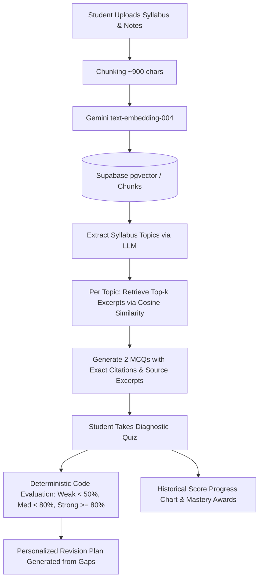

# GapFinder AI

> **"Find what you don't know you don't know."**  
> Students often study everything equally and still miss what they don't know. GapFinder AI takes a student's syllabus, textbook chapters, notes, and past question papers, finds their weak areas, and builds a personalized, prioritized revision plan.

---

## 1. Problem Statement
Traditional study tools and "chat-with-your-PDF" chatbots are passive: they wait for the student to ask questions. However, **a student cannot ask about a gap they do not know they have**. Consequently:
- Students waste 70–80% of revision time repeating comfortable topics while critical blind spots remain untouched.
- Self-assessment before exams is subjective, unstructured, and noisy.
- Generic AI chatbots hallucinate or test general trivia rather than the student's actual course syllabus.

**GapFinder AI solves this by inverting the paradigm**: rather than just answering questions, it diagnoses topic-level comprehension through grounded diagnostic testing, audits weaknesses deterministically, and dynamically builds an actionable revision timetable.

---

## 2. Architecture Overview

GapFinder AI is built with a strictly typed Next.js App Router full-stack architecture, decoupling deterministic database diagnostics from AI generative layers.

```
┌────────────────────────────────────────────────────────────────────────┐
│                        Client UI (Next.js 14)                         │
│   Materials Vault • Topic Map • Diagnostic Quiz • Gap Report • Plan   │
└───────────────────────────────────┬────────────────────────────────────┘
                                    │
                         HTTPS POST /api/[op]
                     (Bearer JWT / Session Token)
                                    │
                                    ▼
┌────────────────────────────────────────────────────────────────────────┐
│                   Next.js API Route Engine (Node.js)                   │
├───────────────────────────────────┬────────────────────────────────────┤
│         Deterministic Layer       │              AI Layer              │
│  - Document parser (PDF/Text)     │  - Gemini text-embedding-004       │
│  - Fixed chunking (~900 chars)    │  - Gemini 2.0 Flash generation     │
│  - Code-based gap diagnosis (<50%)│  - Grounded question generation    │
│  - Row-Level Security enforcement │  - Grounded conversational tutor   │
└───────────────────┬───────────────┴──────────────────┬─────────────────┘
                    │                                  │
                    ▼                                  ▼
┌──────────────────────────────────────┐  ┌──────────────────────────────┐
│        Supabase Database             │  │      Google AI Studio        │
│  - Postgres + pgvector (768-dim)     │  │  - text-embedding-004        │
│  - Documents, Chunks, Topics, Answers│  │  - gemini-2.0-flash          │
│  - match_chunks() cosine similarity  │  │                               │
└──────────────────────────────────────┘  └──────────────────────────────┘
```

### Flow Diagram (Mermaid)


---

## 3. RAG Pipeline Breakdown

The Retrieval-Augmented Generation (RAG) architecture guarantees zero hallucinations by enforcing strict isolation between retrieval and generation:

### 1. Document Ingestion & Chunking
- Files are parsed (`pdf-parse` for PDF documents, UTF-8 for plaintext/markdown).
- Content is segmented by paragraph boundaries with a target chunk size of **~900 characters** (`src/lib/rag.ts:chunk()`).
- Each chunk preserves its source document reference and sequential index (`idx`).

### 2. High-Dimensional Vector Embeddings
- Chunks are batched and embedded using Google's `text-embedding-004` producing **768-dimensional dense vectors** (`src/lib/ai.ts:embed()`).
- Vectors are stored directly in PostgreSQL with the `pgvector` extension and indexed using **HNSW cosine distance** (`vector_cosine_ops`).

### 3. Cosine Similarity Retrieval
- User queries and topic keywords are embedded into the same 768-d vector space.
- A PostgreSQL stored procedure (`match_chunks`) performs cosine similarity search:
  ```sql
  select c.id, c.content, d.name, c.idx, 1 - (c.embedding <=> q) as sim
  from chunks c join documents d on d.id = c.document_id
  where c.user_id = auth.uid()
  order by c.embedding <=> q limit k;
  ```
- **Hallucination Shield**: For student Q&A, the tutor strictly refuses to answer if the top excerpt similarity is below `0.40`.

---

## 4. AI Workflow & Feature Breakdown

| Feature | How It Works | Grounding & Separation |
|---|---|---|
| **1. Material Vault** | Upload syllabus, lecture notes, textbook chapters, or past question papers. | Indexed with document kind tags (`syllabus`, `notes`, `past paper`). |
| **2. Topic Map** | Structures syllabus chunks into 6–12 distinct study modules. | Derived only from syllabus chunks; creates an auditable taxonomy. |
| **3. Diagnostic Quiz** | Automatically retrieves top excerpts for each topic and generates 2 MCQs per topic. | **Zero generic trivia**: questions carry direct citations (`doc §idx`) and source excerpts. |
| **4. Gap Report** | Classifies every topic as **Weak** (<50%), **Medium** (<80%), or **Strong** (>=80%). | **Not generated by LLM**: computed strictly in deterministic TypeScript code from answers. |
| **5. Revision Plan** | Allocates revision minutes based on student's available days and daily study hours. | Prioritizes weak topics with deep dives, medium with targeted practice, strong with quick checks. |
| **6. Explain Assistant** | Grounded conversational tutor for student questions. | Uses only retrieved excerpts; cites them as `[1]`, `[2]`, refusing if excerpts lack the answer. |
| **7. Progress Dashboard**| Visual trajectory chart of quiz scores over time. | Audits score history and grants knowledge mastery milestones. |
| **8. Authentication** | Multi-tenant auth with Row-Level Security (RLS) ensuring students only see their own data. | Supports demo credentials and instant offline demo mode for competition judging. |

---

## 5. Clarity on AI Usage: Retrieval vs. Generation vs. Code

To ensure grading auditability, GapFinder AI maintains clear boundaries between components:
- **Retrieval (No LLM):** Pure vector cosine mathematics in `pgvector` using 768-d embeddings.
- **Diagnosis (No LLM):** The Gap Report (`weak`/`medium`/`strong`) is computed deterministically in code (`gaps()` in `src/lib/rag.ts`), ensuring ratings cannot hallucinate.
- **Generation (LLM Restricted):** Gemini only receives retrieved excerpts in prompts with explicit system constraints: *"Use ONLY the excerpts below. Use no outside knowledge. Cite source excerpt numbers."*

---

## 6. Setup & Execution Instructions

### Prerequisites
- Node.js 18+ (tested on Node v20/v24)
- NPM or PNPM

### Quickstart (Local Demo Mode - Zero Keys Needed)
1. Clone the repository and install dependencies:
   ```bash
   git clone https://github.com/your-username/gapfinder-ai.git
   cd gapfinder-ai
   npm install
   ```
2. Start the development server:
   ```bash
   npm run dev
   ```
3. Open **http://localhost:3000** in your browser.
4. **Demo Mode** is active automatically with sample DBMS curriculum preloaded. Click **Sign in** with prefilled credentials:
   - **Email:** `demo@gapfinder.app`
   - **Password:** `Demo@1234`

### Production Setup (Connecting Supabase & Gemini)
1. Create a project at [supabase.com](https://supabase.com) and run `supabase/schema.sql` in the SQL Editor.
2. Get a Gemini API key at [aistudio.google.com](https://aistudio.google.com).
3. Populate `.env.local`:
   ```env
   NEXT_PUBLIC_SUPABASE_URL=https://your-project.supabase.co
   NEXT_PUBLIC_SUPABASE_ANON_KEY=your-anon-key
   SUPABASE_SERVICE_ROLE_KEY=your-service-role-key
   GEMINI_API_KEY=your-gemini-api-key
   GEMINI_MODEL=gemini-2.0-flash
   ```
4. Seed the demo user:
   ```bash
   node --env-file=.env.local scripts/create-demo-user.mjs
   ```

---

## 7. Limitations & Future Scalability

### Current Limitations
- **Scanned Image PDFs:** Documents must contain selectable text (no embedded OCR engine yet).
- **Synchronous Ingestion:** Very large textbook PDFs (>100 pages) can exceed serverless 60s execution limits; recommended in sections.
- **Diagnostic Sample Size:** Diagnostic testing relies on ~2 MCQs per topic as a cognitive signal rather than an exhaustive final exam.

### Future Roadmap
1. **Teacher & Class Analytics:** Class-wide heatmaps showing collective weak topics across cohorts.
2. **Parent Progress Tracking:** Weekly digest reports highlighting revision consistency and resolved gaps.
3. **Multi-Subject & Multi-Language:** Automated translation and multi-course workspace tabs.
4. **Automated Spaced Repetition:** Push notifications or calendar invites aligned with the Ebbinghaus forgetting curve.
5. **LMS Integration:** Canvas, Moodle, and Google Classroom gradebook synchronization.
